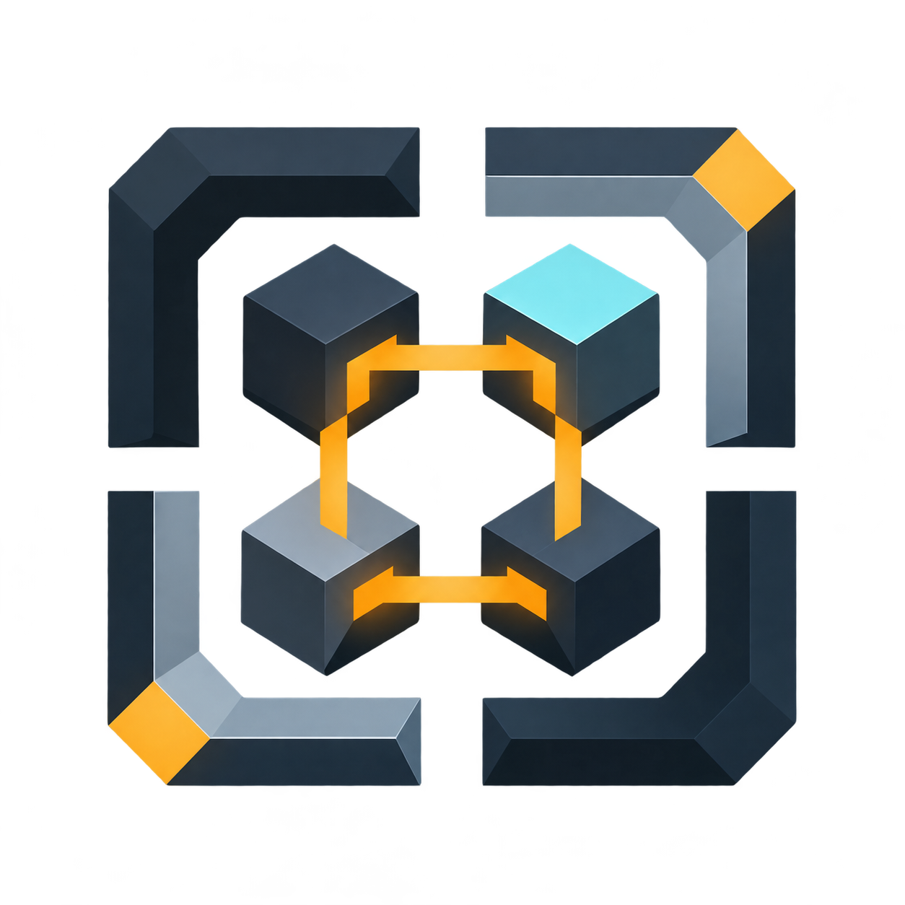
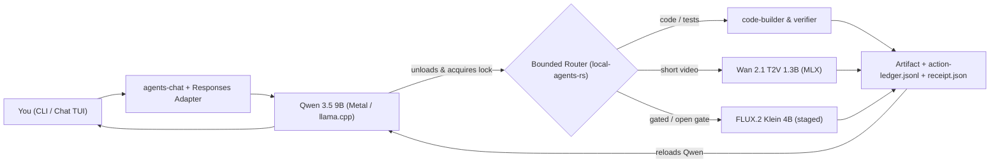

<p align="center">
  
</p>

<h1 align="center">Syndicate Recursive Harness</h1>

<p align="center">A local-first recursive agent harness: run Qwen on Apple Silicon, route tasks across bounded specialist workers, and verify every output with hardware-guarded receipts.</p>

<p align="center">
  <a href="LICENSE"></a>
  
  
  
</p>

> **Release status (local alpha candidate):** The Rust control plane and installer have 111 unit/integration tests passing; the deterministic context compactor, adapter, model manifest, MNX-AGI A/B evaluator, OT/ICS exposure auditor, and Nexus topology graph suite has 18 Node tests passing. The SHA-256 weight downloader, no-model source install, bundled `forge` loopback web console, capability-based media routing, model profile resolver, Article VI Private LLM Sanctum (`0600`), hash-pinned `ot-ics-defense` critical infrastructure skill set, and one authenticated extracted-repository Qwen Metal smoke check are locally verified on Apple Silicon. Clean external-machine installation, routed chat/code/any-to-any and Wan qualification, a signed/notarized release, and end-to-end FLUX image encoder licensing/assembly remain open gates.

---

## Why Syndicate Recursive Harness

Running coding agents, vision models, and video generators on a single 16–36 GB unified-memory Mac usually ends in OOM kills or runaway loops. **Syndicate Recursive Harness** solves both at the control-plane level:

- **One-heavy-model lock:** A shared OS lock keeps Qwen, Wan, and FLUX from competing for unified memory when every adapter uses the packaged contract. An optional `SYNDICATE_HEAVY_LOCK` override must resolve to an absolute path; surrounding whitespace is normalized consistently by Rust, Python, and the installer.
- **Bounded recursive routing:** A syndicate graph (`syndicates/creative-relay/syndicate.json`) caps dispatch rounds, edge iterations, allowed tools, allowed hosts, and wall-clock budgets.
- **Deterministic context compaction:** Conversations begin compacting at an estimated `10,800` tokens, keep connected tool calls/results together, preserve the latest user task byte-for-byte when it fits, and reject an oversized latest task instead of silently cutting out requirements.
- **Auditable execution:** Every run writes an `action-ledger.jsonl` and `receipt.json` alongside artifacts—observability without exposing private chain-of-thought.



---

## One-Command Build & Model Install

**Prerequisites:** Apple Silicon Mac (`arm64`), [Homebrew](https://brew.sh), and [Rust/Cargo](https://rustup.rs).

```bash
git clone https://github.com/multinex-ai/syndicate-recursive-harness.git
cd syndicate-recursive-harness
./install.sh --models core
export PATH="$PWD/bin:$PATH"
agents-chat
```

`./install.sh` compiles the Rust workspace (`syndicate-installer` + `local-agents-rs`), provisions an isolated `uv` Python 3.12 MLX environment, installs the pinned `codex` TUI binary, and downloads + SHA-256 verifies your chosen model set:

| Model Set | Included Weights | Approx. Size | Use Case |
|---|---|---:|---|
| `core` | Qwen 3.5 9B Q4_K_M + BF16 vision projector | 6.5 GB | Local chat, coding, tool calls, vision |
| `creative` | Wan 2.1 1.3B + UMT5 Q8 + staged FLUX.2 Klein 4B | ~12.0 GB | Short text-to-video; stages image base |
| `all` | `core` + non-gated `creative` | ~18.5 GB | Full local text, code, vision, and video |
| `none` | Runtime & binaries only | < 100 MB | Development, testing, and CI |

> **Optional gated research encoder:** The uncensored FLUX.2 text encoder (`flux-non-commercial-v2.1`) is excluded from `all`. After accepting its terms on Hugging Face, opt in explicitly:
> ```bash
> HF_TOKEN=hf_... node scripts/models/download.mjs --set creative --include-gated flux2-encoder
> ```

Dry-run, manage models, or verify an existing machine without rebuilding:

```bash
cargo run --quiet -p syndicate-installer -- plan --models core
cargo run --quiet -p syndicate-installer -- doctor --models core
cargo run --quiet -p syndicate-installer -- models --models creative
node scripts/models/download.mjs --set all --dry-run
cargo run --quiet -p syndicate-installer -- uninstall
```

---

## What the UI Looks Like

### 1. Interactive Terminal Chat (`agents-chat`)

After the core model is installed and runtime qualification passes, `agents-chat` boots the local Responses adapter on `127.0.0.1:18087`, wires the `local_agent_workers` MCP bridge, and opens an isolated terminal UI. The following is the intended interaction, not a current clean-machine acceptance receipt:

```text
Local Syndicate Harness² • Qwen loads per reply and unloads before worker dispatch
Context: 16384 tokens • compact: 10800 • hard stop: 14300
╭──────────────────────────────────────────────────────────────────────────────╮
│ >_ local-agent (local_syndicate) • workspace: ~/projects/weather-cli         │
╰──────────────────────────────────────────────────────────────────────────────╯
you › Create a typed TypeScript weather parser in ./src, run its tests, and
      summarize the result.

assistant ›
  • Planning in workspace-write mode (context: 1,420 / 16,384 tokens)
  • Calling tool: exec -> `npm test`
  ✓ 6/6 tests passed in 142ms
  Created `src/parseWeather.ts` and `tests/parseWeather.test.ts` with strict
  types and zero `any` casts. All 6 tests pass.

you › /quit
```

Useful TUI commands: `/quit` (exits cleanly without leaving Qwen resident), `agents-chat resume --last` (reopens your last session), or `SYNDICATE_WORKSPACE=/path/to/repo agents-chat`.

### 2. Direct Control Plane & Recursive Relay (`local-agents-rs`)

Invoke bounded multi-worker relays, standalone media generation, or live Metal smoke checks directly from the compiled Rust binary after installing the required model pack:

```bash
# Run the bounded recursive relay (conductor -> code-builder -> verifier)
./target/release/local-agents-rs agent conductor \
  "Build a typed JSON log summarizer in ./sandbox, run its tests, and verify the receipt" \
  --dispatch-limit 6 --timeout 1800

# Check system memory admission & heavy-model lock status
./target/release/local-agents-rs resources
./target/release/local-agents-rs status

# Generate a self-contained HTML run report, launch the Forge console, or record an Article VI Sanctum reflection
./target/release/local-agents-rs report runs/<run_id>
./target/release/local-agents-rs forge --port 4287
./target/release/local-agents-rs sanctum record centra-actual "Prioritize SBOM lockfile audit before red-team dispatch"
```

> **Loopback Web Console (`forge`):** `local-agents-rs forge` starts a `127.0.0.1`-only HTTP control plane with a 0600 bearer token (`shared/runtime/forge/token`) and serves `shared/forge-console/` to inspect live memory admission, heavy-model lock state, syndicate rosters, and bounded mission dispatches.

---

## Packaged Syndicates & Multi-Node Cluster Topology

### 1. ISA Task Force Orange — `syndicates/isa-centra-spike/`

Modeled on the U.S. Army Intelligence Support Activity (**CENTRA SPIKE** / **Task Force Orange** / **GREY FOX**), this four-element tactical intelligence and defensive cyber detachment operates under strict host/tool allowlists:

| Callsign (`agent_id`) | Detachment Role | Primary Function & Allowed Surface |
|---|---|---|
| **`centra-actual`** | *CENTRA ACTUAL* — TOC Commander & All-Source Fusion Lead | Decomposes directives into collection, recon, and hardening orders; synthesizes after-action sitreps |
| **`orange-watch`** | *ORANGE WATCH* — SIGINT/OSINT Threat Warning Element | Monitors allowlisted CISA KEV, NVD, diplomatic/maritime feeds, and wire services for WARNINT indicators |
| **`greyfox-recon`** | *GREYFOX RECON* — Special Reconnaissance & Surface Cartographer | Maps local asset inventories, SBOM dependency trees, and attack-surface exposure graphs |
| **`timberwolf-red`** | *TIMBERWOLF RED* — Defensive Exploitation & Countermeasure Element | Authors isolated vulnerability reproduction tests, OWASP/CWE audits, and verified remediation patches |

```bash
./target/release/local-agents-rs agent centra-actual \
  "Have greyfox-recon map Cargo.toml and requirements.lock.txt in this workspace, then have timberwolf-red verify dependency hygiene and report the receipt" \
  --dispatch-limit 6 --timeout 1800
```

### 2. Creative Relay — `syndicates/creative-relay/`

A three-stage code, media, and verification workshop (`conductor` → `code-builder` / `video-studio` → `verifier`) for turning plain-language requests into tested artifacts.

### 3. Single-Mac vs. Multi-Node Cluster Mode (`models/cluster-qwen35-node.json`)

- **Single-Mac Mode (`local-qwen35-9b-uncensored`):** Enforces `requires_heavy_lock: true` so Qwen, Wan 2.1, and FLUX.2 serialize cleanly on a single 16–36 GB unified-memory Mac without OOM pressure.
- **Multi-Node Cluster Mode (`cluster-qwen35-node`):** When running across a 2–4 Mac Thunderbolt Bridge or LAN cluster (`provider_kind: "local_cluster_rpc"`), Node 1 keeps `centra-actual` / `conductor` permanently warm in VRAM (`32,768` context window, zero cold-load latency) while Node 2 runs `greyfox-recon` / `timberwolf-red` and Node 3 runs Wan 2.1 MLX media jobs in parallel.

---

## Example Generations & Receipts

### Example 1: Metal Inference Smoke Check (`model-smoke`)

This command is designed to verify the heavy-model lock, Metal GPU offload via `llama.cpp`, one completion, and clean memory teardown. The JSON below is an example schema, not evidence from this extracted repository:

```bash
./target/release/local-agents-rs model-smoke
```

```json
{
  "run_dir": "runs/rust-model-smoke-1762980000",
  "server_pid": 48210,
  "load_seconds": 3.42,
  "total_seconds": 4.18,
  "reply": "RUST-OK",
  "reply_matches": true,
  "server_stopped": true
}
```

### Example 2: Bounded Recursive Code + Verification Relay (`creative-relay`)

When invoked with `agent conductor`, the harness is configured to dispatch bounded workers (`code-builder` → `verifier`), record every transition in `action-ledger.jsonl`, and enforce `max_dispatch_rounds: 6`. The transcript below illustrates the expected receipt flow:

```text
[conductor]    dispatched code-builder (round 1/6, workspace: syndicates/creative-relay/agents/code-builder/workspace)
[code-builder] wrote src/summarizer.ts + tests/summarizer.test.ts; ran `node --test` (4 passed, 0 failed)
[code-builder] handed off to verifier
[verifier]     re-ran `node --test` -> 4 passed, 0 failed; receipt written
[conductor]    completed with status=ok (2/6 rounds used, 0 retries)
```

### Example 3: Local Text-to-Video Generation (Wan 2.1 1.3B on MLX)

```bash
./target/release/local-agents-rs video \
  "A slow camera push toward a faceted amber and cyan modular relay in a dark studio, restrained motion, no text" \
  --preset draft --output ./relay-draft.mp4
```

Successful output includes the decoded `.mp4` clip plus kernel telemetry (`mlx_peak_bytes_by_phase` across T5 conditioning, flow denoising, and VAE decoding, `finite_pixels: true`, and `mean_absolute_frame_change`). The extracted path still requires runtime qualification. *(Requires `ffmpeg` and the `creative` model set; see [docs/tutorials/generate-video.md](docs/tutorials/generate-video.md) for current pipeline status.)*

---

## Context & Memory Guard Defaults

Configured for real 18 GB unified-memory Macs where the OS, KV cache, and tools share RAM:

| Setting | Default | Environment Override | Purpose |
|---|---:|---|---|
| Context window | `16,384` | `SYNDICATE_CONTEXT_WINDOW` | Max local request window |
| Compact threshold | `10,800` | `SYNDICATE_COMPACT_AT` | Summarizes older turns into a structured checkpoint |
| Hard stop | `14,300` | `SYNDICATE_HARD_STOP` | Fails fast if compaction cannot fit the budget |
| Recent tail | `10` items | `SYNDICATE_RECENT_ITEMS` | Newest user/assistant/tool pairs kept verbatim |
| Heavy model lock | XDG state | `SYNDICATE_HEAVY_LOCK` | Prevents concurrent heavy model loads across checkouts |

---

## Models & Licensing

Weights are never committed to Git. [`catalog/models/manifest.json`](catalog/models/manifest.json) pins exact Hugging Face revisions, byte counts, and SHA-256 digests:

- **Chat / Code / Vision:** [HauhauCS/Qwen3.5-9B-Uncensored-HauhauCS-Aggressive](https://huggingface.co/HauhauCS/Qwen3.5-9B-Uncensored-HauhauCS-Aggressive) (`Apache-2.0`)
- **Video:** [Wan-AI/Wan2.1-T2V-1.3B](https://huggingface.co/Wan-AI/Wan2.1-T2V-1.3B) & [PandacatAI/umt5-xxl-enc-mlx-q8](https://huggingface.co/PandacatAI/umt5-xxl-enc-mlx-q8) (`Apache-2.0`), [blackshirt/NSFW_Wan_1.3b](https://huggingface.co/blackshirt/NSFW_Wan_1.3b) (`CreativeML Open RAIL-M`, *Not-For-All-Audiences*)
- **Image (staged):** [Runpod/FLUX.2-klein-4B-mflux-4bit](https://huggingface.co/Runpod/FLUX.2-klein-4B-mflux-4bit) (`Apache-2.0`); optional [ponpoke/flux2-klein-4b-uncensored-text-encoder](https://huggingface.co/ponpoke/flux2-klein-4b-uncensored-text-encoder) (`FLUX Non-Commercial v2.1`, gated)

Users are responsible for consent, applicable law, and upstream model licenses. Never use this software for non-consensual intimate imagery, CSAM, impersonation, or targeted harm.

---

## Repository Map & Verification

```text
syndicate-recursive-harness/
├── bin/agents-chat                 one-command local chat TUI launcher
├── installer/                      Rust plan / doctor / install CLI (syndicate-installer)
├── shared/rust-harness/            Rust control plane (local-agents-rs: jobs, locks, tools, reports)
├── shared/chat/                    Responses API adapter + deterministic context compactor
├── shared/harness/                 Python/MLX inference & media kernels
├── shared/forge-console/           Loopback Syndicate Forge web console UI
├── agents/                         Base worker definitions (browser, coordinator, desktop, etc.)
├── syndicates/creative-relay/      Code, media, and verification relay graph
├── syndicates/isa-centra-spike/    ISA Task Force Orange (CENTRA SPIKE) recon & audit detachment
├── catalog/models/                 SHA-256 pinned weight & CLI manifests
├── scripts/models/                 Resumable, hash-verified Hugging Face downloader
├── scripts/verify/                 Repository contract verifier & MNX-AGI A/B run evaluator
└── docs/tutorials/                 Step-by-step guides
```

Run the local test suites:

```bash
cargo test --workspace
node --test shared/chat/test-context-manager.mjs shared/chat/test-local-responses-adapter.mjs scripts/models/test-models.mjs scripts/verify/test-evaluate-runs.mjs scripts/verify/test-audit-ot-exposure.mjs scripts/verify/test-nexus-graph.mjs
```

See [SECURITY.md](SECURITY.md), [CONTRIBUTING.md](CONTRIBUTING.md), [NOTICE](NOTICE), and [docs/architecture/README.md](docs/architecture/README.md).

The current architecture, folder map, technical-debt register, separation state, and release path are in the offline [interactive architecture report](reports/syndicate-recursive-harness-report.html).
