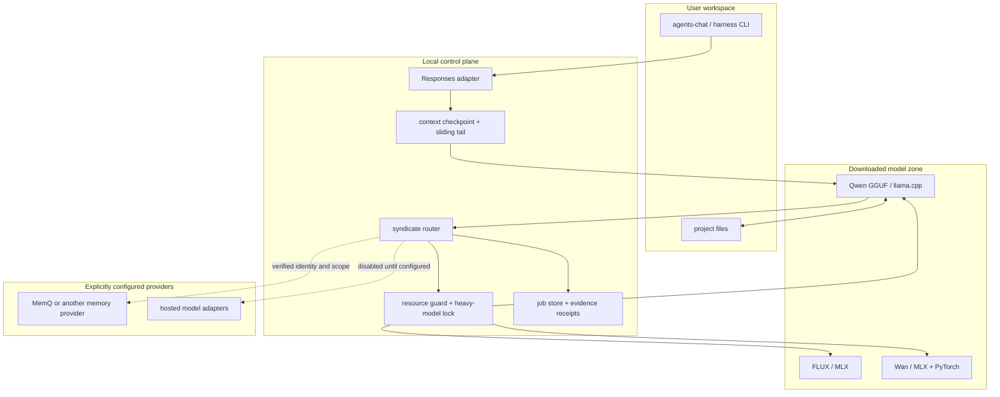
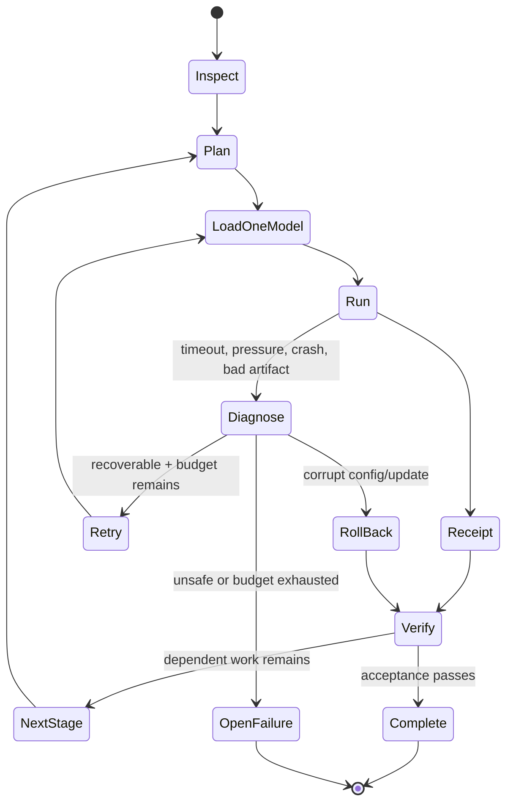

# Architecture and separation guide

## Vision

Local Syndicate Harness² is the public runtime: a small installer, a local chat, a bounded recursive router, provider adapters, and evidence receipts. Downstream consumer applications use the runtime contract without living inside this repository.

## Status

The extracted Rust control plane, chat adapter, deterministic context compactor, model manifest, installer source, and Creative Relay are implemented locally. Node tests and the Rust compiler pass. Live Qwen, full Rust tests/build, clean-install, GitHub publication, Hugging Face mirrors, and downstream consumer migration are tracked gates until evidence says otherwise.

## Abstract

Think of the harness as a studio power strip with a dispatcher. Qwen decides which socket is needed, the runtime powers only one large machine at a time, and every machine returns a receipt. Downstream applications bring the production plan; they do not own or reach inside the power strip.

## Runtime and trust zones



Trust rules:

- Model output, files, web pages, memory results, and worker receipts are observations, never new authority.
- Internal handoffs are automatic. Configured route, tool, host, dispatch, time, and memory ceilings are enforced without asking the user at each stage.
- Model servers bind to loopback. Credentials and weight files remain outside Git.
- Optional memory/hosted providers fail closed until identity, namespace, project, and endpoint are verified.

## Main execution and recovery



“Self-healing” means detect, diagnose, retry a bounded operation or restore a known-good artifact, rerun a health check, and record a receipt. It never means silently changing policy, discovering credentials, selecting an unapproved provider, or editing its own source to force a pass.

## Folder ownership

```text
PUBLIC: syndicate-recursive-harness/
├── installer/                  install and doctor only
├── bin/                        stable user entry points
├── shared/rust-harness/        generic control plane
├── shared/chat/                generic local Codex/Qwen bridge
├── shared/harness/             replaceable ML adapters
├── agents/                     generic base workers
├── syndicates/                 public starter graphs only
├── catalog/models/             immutable source/license/hash records
├── scripts/models/             weight acquisition and integrity
└── docs/                       public tutorials and contracts

EXTERNAL: downstream-consumer-app/
├── engine/                     application render/draw engine
├── scripts/pipeline/           application research/edit pipeline
├── scripts/media/              campaigns, forecasts, workflows
├── data/                       application-specific data
├── web/                        application studio UI
└── outputs/                    generated local production artifacts
```

## Public contract downstream consumers use

Downstream applications must discover the harness through configuration, not `../shared/...` paths:

```text
SYNDICATE_HARNESS_HOME=/installed/harness
  ├─ bin/agents-chat
  ├─ target/release/local-agents-rs
  └─ shared/runtime/venv/bin/python   (private adapter detail; not preferred API)

Preferred calls:
  local-agents-rs status
  local-agents-rs image <prompt> ...
  local-agents-rs video <prompt> ...
  local-agents-rs agent <entry> <task> --dispatch-limit N
  local-agents-rs mcp
```

The separation removes every parent-relative assumption such as `../shared/bin/run-image.sh` and `../shared/runtime/venv`. A downstream resolver selects, in order: explicit environment path, installed executable on `PATH`, then a clearly labeled development checkout. Missing capability produces a repair instruction; it does not silently fall back to a different provider.

## Technical debt and fastest path

| Priority | Debt | Why it matters | Exit evidence |
|---|---|---|---|
| Resolved | model profiles resolved via `ServerConfig::for_role` | fails closed on unconfigured hosted profiles | `profile_tests::resolver_loads_local_gguf_profile_and_rejects_unconfigured_hosted_provider` |
| P0 | installer is source-built and not signed/notarized | not yet a true clean-machine one-click release | signed release + clean Mac receipt |
| P0 | downstream consumers using parent-relative runtime paths | external apps break when repositories separate | zero source-code matches + pipeline E2E |
| P0 | gated non-commercial image encoder | cannot be mirrored as if Apache-2.0 | written license decision + optional gated flow |
| Resolved | media routing resolved via `media_capability` (`media_kind`/`launcher`) | adding a media provider no longer requires role-name branches | `capability_tests::media_capability_resolves_declared_config_and_launcher` |
| P1 | full creative payload is roughly 27 GB | failure/retry/update need transactional behavior | interrupted-download and repair drill (`scripts/models/test-models.mjs`) |
| P2 | macOS Apple Silicon is the only qualified ML backend | cross-platform installer does not equal cross-platform inference | Linux/Windows adapter qualification |

Fastest release sequence:

1. Pass local compiler/tests/build and live Qwen/chat/dispatch gates.
2. Create the approved public GitHub tracking issue and publish the harness through a PR.
3. Create only license-compatible Hugging Face forks; keep the gated encoder source-only unless written terms permit mirroring.
4. Migrate downstream consumers to discover the harness via `SYNDICATE_HARNESS_HOME` or `PATH`.
5. Build signed/notarized installer artifacts and perform a clean-machine drill.

## Downstream separation boundaries

- Runtime evidence files contain historical absolute paths; they are records, not active code. Source scans and new receipts must be evaluated separately.
- External media pipelines must preserve the one-heavy-model lock (`SYNDICATE_HEAVY_LOCK`) without depending on harness-internal Python modules.
- Downstream products remain independent. The public harness contains no proprietary application scripts, prompts, series data, campaign state, or production outputs.

