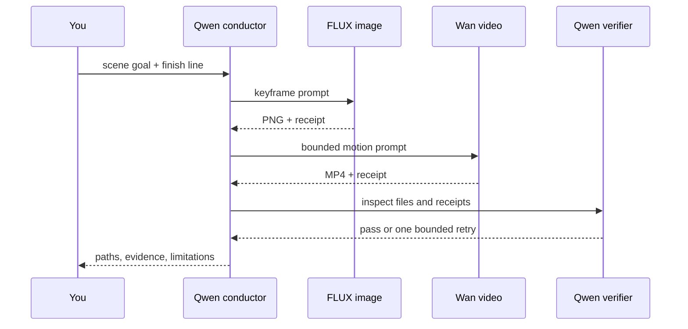

# Route a scene from idea to checked artifacts

The packaged Creative Relay can move through multiple local workers automatically:

```bash
./target/release/local-agents-rs agent conductor \
  "Create a launch scene for a local agent harness. First define the shot and generate a still keyframe. Then generate a matching short motion prompt. Return both artifact receipts and have the verifier check the project files." \
  --dispatch-limit 6 --timeout 1800
```



The relay does not ask for approval between internal handoffs. It still stops when the configured dispatch count, relationship cap, wall-clock deadline, or resource guard is reached. Only one heavy model runs at a time.

External production pipelines can consume this same public capability contract (`local-agents-rs` CLI and MCP bridge) while keeping application-specific generators and project data in their own repositories.

